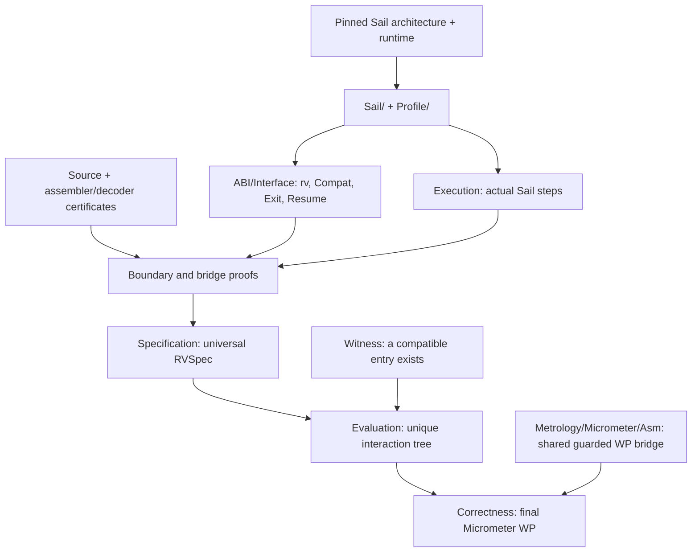

# How the assembly proofs fit together

Start with [swap correctness](Examples/Swap/Correctness.lean) or
[callback correctness](Examples/Callback/Correctness.lean). Each states the final Micrometer result.
Then read the matching `Source.lean` and `Specification.lean` to see the assembly and its plain
machine contract. The keypair directory contains input and a game skeleton; it has no correctness proof.

## Directory map

| Directory | Responsibility | Entry points |
|---|---|---|
| `Sail/` | Actual Sail stepping, register/memory effects, fetch/decode and instruction rules | [Execution](Sail/Execution.lean), [InstructionRules](Sail/InstructionRules.lean) |
| `Profile/` | User-mode policy, register initialization, reductions and a consistency witness | [Config](Profile/Config.lean), [Witness](Profile/Witness.lean) |
| `ABI/` | Instantiate the generic FFI machine interface using Sail and the ABI facets | [Interface](ABI/Interface.lean), [Lemmas](ABI/Lemmas.lean), [Resume](ABI/Resume.lean) |
| `Examples/Swap/` | Complete two-cell swap proof | [Source](Examples/Swap/Source.lean), [Correctness](Examples/Swap/Correctness.lean) |
| `Examples/Callback/` | Complete assembly → ProbLang callback → assembly round trip | [Source](Examples/Callback/Source.lean), [Correctness](Examples/Callback/Correctness.lean) |
| `Examples/OTP/` | One-byte OTP implementation in progress | [Source](Examples/OTP/Source.lean), [plan](../docs/asm-ffi/OTP-PLAN.md) |
| `Examples/Keypair/` | Linked TweetNaCl source, declared signature and planned game | [Source](Examples/Keypair/Source.lean) |
| `Examples/Support.lean` | Concrete byte installation, placement and register fixtures shared by example witnesses | [Support](Examples/Support.lean) |
| `Diagnostics/` | Concrete observations and a small instruction-body experiment | [Spike](Diagnostics/Spike.lean), [InstructionBody](Diagnostics/InstructionBody.lean) |

`Sail/` and `Profile/` together form the machine foundation: basic step-state operations support the
profile, whose policy then supports configured memory/fetch/instruction rules. `ABI/` builds on that
foundation. Shared machine/ABI modules do not import example or diagnostic modules. Neither verified
example imports the other; their concrete witnesses share `Examples/Support.lean`.

## From source to the final theorem



Both verified examples use these filenames:

1. **`Source.lean`** contains literal GNU assembly, its signature and the first-class code value.
2. **`Decode.lean`, `Steps.lean`, `Execution.lean`** connect concrete instruction words to the official
   decoder and compose actual `try_step` executions. Swap also has `Assembler.lean` and `Layout.lean`.
3. **`Boundary.lean` and bridge files** translate between logical heaps and the physical machine.
   Swap uses `Bridge.lean`; callback uses `Placement`, `Image`, `Frames` and `Observation`.
4. **`Specification.lean`** proves `swap_rvspec` or `importToy_rvspec` for every compatible entry;
   callback additionally covers every valid response and allowed resumed state.
5. **`Witness.lean`** proves compatible entries exist, and **`Evaluation.lean`** selects the unique
   canonical return/callback tree. Callback's local uniqueness helpers are in `EvaluationRules.lean`.
6. **`Correctness.lean`** proves `wp_swap_spec` or `wp_importToy_spec` under the actual guarded WP.
   Callback's intermediate conditional WP is in `Micrometer.lean`.

The swap owns two distinct signed-64 cells. The callback toy has an empty logical footprint and a
16-byte stack frame. Keypair is explicitly unproved; its source/fixture checks establish an input,
not an RVSpec or cryptographic postcondition.

## Imports and commands

Declaration names remain in `MetrologyAsm` (and `ProbLang.Asm` for the swap source). File organization
changes Lean module paths; the final theorem names `wp_swap_spec` and `wp_importToy_spec` stay the same.
Use a focused import:

```lean
import MetrologyAsm.Examples.Swap
-- or
import MetrologyAsm.Examples.Callback
```

`import MetrologyAsm` exports the examples, including the OTP foundations currently in progress. Diagnostics have explicit imports and are checked
by `Tests/SailSpike.lean`. From the repository root:

```sh
lake build
lake build MetrologyAsm.Examples.Swap MetrologyAsm.Examples.Callback
python3 -I scripts/check-sail-pin.py
python3 -I fixtures/keypair/generate.py --check
```

The generic language/FFI definitions live in `Metrology/ProbLang/Asm/`; the guarded logic bridge lives
in `Metrology/Micrometer/Asm.lean`. Vendored architecture/runtime sources remain in `RiscvZkvm/` and
`runtime/lean-sail/`. See [the evaluation report](../docs/asm-ffi/REPORT.md) and
[statement dependency audit](../docs/asm-ffi/TCB.md) for scope, provenance and limits.
